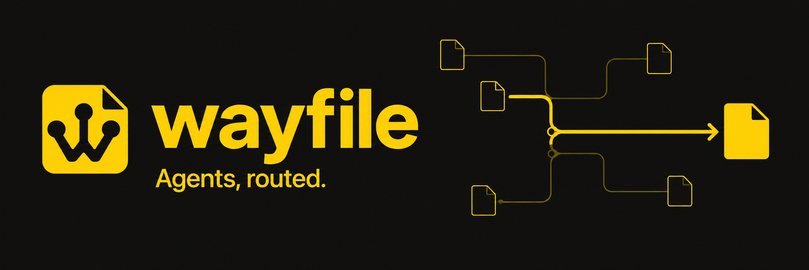
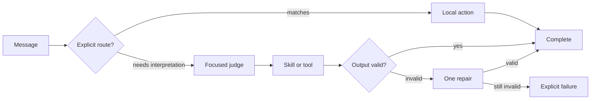

<p align="center">
  
</p>

<p align="center">
  <strong>Fast paths. Reviewable decisions. Models where they matter.</strong>
</p>

<p align="center">
  
  
  
</p>

<p align="center">
  <a href="#quickstart">Quickstart</a> ·
  <a href="#how-it-works">How it works</a> ·
  <a href="#give-it-tools">Tools</a> ·
  <a href="#quality-before-savings">Quality</a> ·
  <a href="#what-weve-measured">Benchmarks</a> ·
  <a href="docs/DESIGN.md">Design</a> ·
  <a href="assets/brand/README.md">Brand kit</a>
</p>

# Give your agent a route.

Wayfile turns a folder of Markdown files into an executable agent workflow. Write policy as explicit routes, run tools as ordinary executables, and use a bounded tool harness when a task needs investigation.

A clear decision takes the fast path with **zero model calls**. A messy request reaches a focused semantic fork. Authored route decisions identify their source file and line; script-selected targets identify their node file.

Built for support triage, CI workflows, repository investigation, and other tasks where people need both a quick response and a decision they can review.

## 4.57× fewer tokens than Vercel Eve in our routing benchmark

Matched against the **actual Eve 0.79.0 runtime fixture**, using the same model and 32 public development cases:

| Measured result | Wayfile | Actual Eve | Difference |
| --- | ---: | ---: | ---: |
| Provider-reported tokens¹ | **22,536** | 102,885 | **4.57× fewer** |
| Model requests | **26** | 48 | **45.8% fewer** |
| Model API cost per successful contract | **$0.000062591** | $0.000227194 | **3.63× lower** |
| Full routing contracts passed | **32/32** | 29/32 | 3 more |

¹ Includes input, output, cache-read, and cache-write tokens. Token counts and API charges are separate measures; cached tokens have different pricing. These are development cases with fixture data and simulated approvals, not a claim of general superiority. [Sanitized measurements](bench/evidence/routing-2026-10-13.json) · [Evidence and limits](docs/bench-quality-2026-10-13.md) · [Reproduce](bench/EXPERIMENT.md)

| What you need | What Wayfile gives you |
| --- | --- |
| Fast predictable decisions | Local predicates and scripts; no model round trip on deterministic paths. |
| A workflow you can inspect | Markdown nodes, explicit targets, example tests, and source-linked traces. |
| Interpretation when wording changes | Semantic fallback and optional ambiguity handling, with a fixed target set. |
| Tools for open-ended work | A bounded model/tool loop with explicit capabilities, scoped file helpers, and injectable adapters. |
| Validated output contracts | JSON schema contracts, nonempty text validation, and at most one repair after invalid output. |
| Human control | Explicit `ask` nodes, optional [Notify](https://notify.belweave.ai/) approvals, and no implicit approval. |

**Early development:** the goal is lower cost per verified successful task with quality preserved. The measured development comparison is below; broad Eve parity and “cheapest framework” remain unproven.

## Quickstart

Requires **Node.js 20.6.0+**. No runtime dependencies or native build toolchain.

```sh
git clone https://github.com/Belweave/wayfile.git
cd wayfile
npm install

npm run wayfile -- init ../my-agent
npm run wayfile -- check ../my-agent

# A deterministic route: no model key needed.
npm run wayfile -- explain ../my-agent --input '{"message":{"text":"please unsubscribe me"}}'
```

Add a model to interpret requests and generate replies:

```sh
# Export OPENROUTER_API_KEY in your shell first.
npm run wayfile -- run ../my-agent --input ../my-agent/input.json

# Inspect the graph or the changes you made.
npm run wayfile -- mermaid ../my-agent
npm run wayfile -- diff ../my-agent
```

OpenRouter is preferred when `OPENROUTER_API_KEY` is present. Set `WAYFILE_MODEL` to choose a model; the current OpenRouter default is `anthropic/claude-haiku-5.5`. Direct Anthropic calls use `ANTHROPIC_API_KEY` when no OpenRouter key is set.

For a local environment file, copy [.env.example](.env.example) to `.env`, fill in the key locally, and run `node --env-file=.env packages/wayfile/bin/wayfile.js run <agent-dir> --input <file>`. The CLI does not load environment files automatically. You can also install the root aggregate package globally with `npm install -g .`; it exposes both `wayfile` and `waycode` commands.

## How it works

One file describes one step. A node declares the state it reads, the state it writes, and the routes it can take.

```markdown
---
kind: judge
entry: true
needs: [message.text]
max_attempts: 2
---
# Read the message
Interpret the sender's actual intent. Do not treat quoted or negated requests
as instructions.

## Routes
- `message.text ~ /^please unsubscribe me[.!]?$/i` → [[unsubscribe]]
- judge: "is the sender actually asking to stop receiving messages?" → [[unsubscribe]]
- judge: "is the sender reporting a product bug?" → [[bug-report]]
- otherwise → [[draft-reply]]
```

The explicit unsubscribe request takes the deterministic route. Other wording reaches the model, which sees the node policy, eligible target descriptions, and only `message.text`. It must return one allowed target as complete JSON.



```text
my-agent/
├── AGENT.md                 Always-on policy
├── start.md                 Entry node and routes
├── bug-report.md            Structured generation step
├── draft-reply.md           Reply generation step
├── done.md                  Terminal node
├── skills/
│   ├── bug-summary.md       Instructions loaded for one step
│   └── reply-style.md
├── schemas/
│   └── bug-summary.json     Output contract
└── tools/
    └── lookup-order.mjs     Executable tool
```

### Seven node kinds

| Kind | Executes |
| --- | --- |
| `route` | State predicates and a fallback. |
| `judge` | Predicates first, then a model when the fork needs interpretation. |
| `script` | An executable that reads state JSON on stdin and returns a declared state patch. |
| `skill` | A focused model call using the node body and an optional skill file. |
| `harness` | A bounded model/tool conversation that returns text or schema-validated JSON to the graph. |
| `ask` | An explicit human decision or an explicitly supplied test response. |
| `end` | A terminal outcome. |

Scripts can be JavaScript, Python, shell, or another executable. They return `{"set":{"order.status":"shipped"},"next":"done"}`; only declared `sets` are applied, and an optional `next` must be a declared route target. Scripts receive the full state for compatibility; raw stdout is parsed locally and never pasted into a model prompt.

Predicates support numeric comparisons, strict equality, `path exists`, regular expressions, and `&&`. The first matching route wins by default. Use `ordered: true` to document intentional precedence, or `routing: ambiguous` to ask a judge when distinct targets match. Ambiguity detection catches overlapping rules; semantic fallback is still needed for negation and unfamiliar wording.

## Give it tools

Keep policy in files. Let a harness node choose the tools needed to do the work.

```yaml
kind: harness
needs: [question]
sets: [report]
tools: [list-files, read-file, search-files]
max_turns: 6
max_tool_calls: 6
output: json
schema: schemas/report.json
```

The built-in registry supports file listing, reads, literal search, guarded writes, and timed shell execution. Only declared tools are offered to the model. Writes and shell require explicit capability flags; sensitive environment files are protected from the file helpers by default.

```sh
npm run wayfile -- run examples/harness \
  --input examples/harness/input.json
```

Use the application API to register browser, web, MCP, domain API, or sandbox adapters. Credentials stay in trusted executor code; `toModelOutput` keeps model-visible results small. Harness results rejoin the graph for verification, approval, or another route. [Tool API and execution limits](docs/HARNESS.md) · [Runnable example](examples/harness/inspect.md)

Host shell is an opt-in executor with host-user permissions. Use an isolated adapter when a task needs a sandbox. Wayfile's bounds and output contracts help control a run; task-specific evidence and verifiers establish success.

## Quality before savings

Saving tokens is useful only when the task still succeeds.

- **Validate the answer.** Use `output: json` and `schema: schemas/result.json` on a skill or harness. The parsed value is written to its single `sets` path. Unsupported schema assertions fail validation instead of being ignored.
- **Bound recovery.** `max_attempts: 2` permits one repair after invalid or truncated output. Set it to `1` to disable repair. Optional `model` and `fallback_model` select the initial model and the repair model. Transport failures fail explicitly.
- **Keep enough evidence.** `needs` controls what a model sees. Include the facts required to decide; a smaller prompt cannot compensate for missing evidence.
- **Do not hide failures.** Invalid routes, malformed tools, and exhausted step limits fail explicitly. Model attempts, billed usage, approvals, and source locations are recorded; failed CLI runs also write a trace.
- **Cache pure work carefully.** `cache: inputs` fingerprints graph policy, loaded skills and schemas, scripts, declared dependencies, and adapter identity. Add `cache_files: [scripts/flaky.txt]` for files a script reads. Arbitrary custom model adapters need a stable `.cacheKey` or `opts.cacheKey`. Ask and harness nodes are never memoized. External data still needs an application freshness policy.

The schema subset supports `type` (including unions such as `['number', 'null']`), `properties`, `required`, `additionalProperties`, `items`, `enum`, `const`, string lengths/patterns, numeric bounds, and array lengths. See the [starter schema](packages/wayfile/templates/agent/schemas/bug-summary.json).

### Human decisions with Notify

`ask` nodes require a configured backend. For a local test, explicitly supply `stub: {"ask":"yes"}` or `stub: {"ask":"no"}` in state.

```sh
# Set NOTIFY_TOKEN locally; opt into a real phone decision.
WAYFILE_NOTIFY=live npm run wayfile -- run ../my-agent --input ../my-agent/input.json
```

The bundled adapter uses Notify's interaction API, waits for a human answer, and records its provenance. Denial and timeout follow your authored routes. See [setup and behavior](docs/NOTIFY.md).

## What we've measured

The latest matched routing run used **`anthropic/claude-haiku-5.5` through OpenRouter and actual Eve 0.79.0** on 32 public development cases:

| Routing contracts, October 13, 2026 | Wayfile | Bash model loop | Actual Eve fixture |
| --- | ---: | ---: | ---: |
| Full task contract success | **32/32** | 27/32 | 29/32 |
| Model requests, including repairs | **26** | 46 | 48 |
| Provider-reported tokens¹ | **22,536** | 61,181 | 102,885 |
| Model API cost per successful task | **$0.000062591** | $0.000175793 | $0.000227194 |
| Median case latency | **1,193 ms** | 1,477 ms | 1,838 ms |

¹ Token totals sum input, output, provider cache-read, and cache-write categories from the 120 metered responses in run `2026-10-13T23-16-59-162Z-challenge-314c3ec7`. Wayfile's breakdown was 2,287 / 2,285 / 14,033 / 3,931; Eve's was 8,419 / 7,226 / 76,272 / 10,968. This README retains the sanitized aggregate; the per-request journals stay in ignored local benchmark storage. Wayfile used **4.57× fewer provider-reported tokens** and was **3.63× cheaper per successful routing contract** than this actual Eve fixture, with three Wayfile-only wins and no Eve-only wins. The denominator includes correct escalation and required lookup/approval evidence. Local tools, infrastructure, and human labor are unpriced. Application memoization was disabled; provider caching was observed, not controlled cold. See [run provenance](docs/bench-quality-2026-10-13.md#provenance-and-reproduction).

These are small, public cases used during development, with simulated approvals and fixture data. They establish an observed result for the named configurations. Independent unseen tasks, repeated runs, and an equivalently optimized deterministic Eve workflow remain necessary before claiming broad superiority. [Current evidence and limits](docs/bench-quality-2026-10-13.md) · [Reproduce the experiment](bench/EXPERIMENT.md)

A separate generated-answer execution matched actual Eve on **4/4 factual/evidence contracts**, at **2.34× lower model API cost per success**. Those contracts check typed facts, reasons, source versions and required observations. Explanation faithfulness needs semantic review; prose heuristics are diagnostics, and the report distinguishes original scores from posthoc grader corrections.

<details>
<summary><strong>Historical 70-case experiment: token savings, quality NO-GO, simulated baselines</strong></summary>

The original 70-case routing experiment (October 13, 2026; `anthropic/claude-haiku-5.5` through OpenRouter) showed substantial token savings and a small accuracy deficit:

| Original routing experiment | Wayfile | Bash/ReAct simulation | Eve-style simulation |
| --- | ---: | ---: | ---: |
| Correct terminal routes | 68/70 | 69/70 | 69/70 |
| Provider-reported tokens | 7,189 | 93,027 | 132,186 |
| Model calls | 24 | 93 | 129 |
| Median case latency | 13 ms | 1,477 ms | 2,577 ms |

That is **12.9× fewer tokens than the Bash simulation and 18.4× fewer than the Eve-style simulation** in that experiment. The original quality gate was **NO-GO**. These historical scores use the earlier graph and an endpoint-only metric.

The Eve-style arm is a handwritten skill loop, **not Vercel's Eve runtime**. The dataset is small and synthetic, and the median mixes deterministic and model paths. It does not establish general task quality, current accuracy parity, or a universal latency advantage. [Original evidence](docs/bench-2026-10-13.md) · [Original decision](docs/GO-NO-GO.md)

</details>

The revised benchmark measures task contracts, failed-call spend, cost per successful task, and latency distributions. It also includes a development challenge set with paraphrases, negation, policy conflicts, and missing inputs.

```sh
npm test
npm run wayfile -- check examples/triage
npm run wayfile -- check examples/ci

# No model calls; unresolved cases are reported as unresolved.
node bench/run.js --dry --dataset challenge

# Install the isolated Eve fixture, then run a matched comparison.
npm --prefix bench/eve-runtime ci
node --env-file=.env bench/run.js --dataset challenge --eve-runtime
```

The isolated Eve fixture pins its runtime and provider SDK. Models, policies, tools, and output contracts are matched and journaled. A simulated pass cannot certify Eve parity. The optional actual Eve fixture requires Node.js 24+; see its [setup guide](bench/eve-runtime/README.md) and the [experiment protocol](bench/EXPERIMENT.md).

## Wayfile and Eve

Both frameworks use files to organize agents. [Eve](https://eve.dev/llms.txt) provides a durable agent runtime with sessions, tools, skills, channels, and evaluation. It already supports [context control and on-demand skills](https://eve.dev/docs/concepts/context-control).

Wayfile concentrates on an explicit outer graph: authored decisions bypass the model, while semantic forks and generation remain focused calls. The source is the workflow, so a routing change can be diffed, tested, and reviewed like application code.

Choose the current Wayfile MVP for bounded, inspectable workflows with fast routes and tool investigation. Durability, OS isolation, channels, and built-in browser/MCP clients need additional application code or adapters.

## A workflow that gets easier to maintain

The next design milestone is **reviewed rule improvement**: use real traffic to identify recurring semantic decisions, propose a narrow rule, replay it against positive cases and counterexamples, and show the exact diff to a person through Notify before promotion.

Rule proposals and automatic promotion are planned, not shipped. We will measure authoring time and rule maintenance alongside cost, quality, and speed. A graph that saves tokens but creates endless policy work has missed the goal. [Design and roadmap](docs/DESIGN.md)

## Commands and development

### Conversational coding agent

`waycode` adds persistent terminal chat, scoped editing, managed host commands and
development servers, independent project checks, and explicit GitHub publication.

```sh
npm run waycode -- chat --workspace ../my-site \
  --check-url http://localhost:3000
```

Export your model API key in the shell before starting Waycode. For a clean
standalone coding-agent folder, run `npm run setup-agent -- ~/Code/waycode-agent`;
the script creates an empty site workspace, a local `.env` placeholder, a runtime
copy, and a `start.sh` launcher. It accepts a new or empty destination and refuses
to overwrite existing files. See [coding agent setup and execution boundaries](docs/CODING.md).

| Command | Purpose |
| --- | --- |
| `wayfile init <dir>` | Scaffold an agent. |
| `wayfile check <dir>` | Validate metadata, routes, dependencies, schemas, and node examples. |
| `wayfile run <dir> --input <json\|file>` | Execute and print state, outcome, calls, usage, and trace path. |
| `wayfile explain <dir> --input <json\|file>` | Show the route and the source line behind each decision. |
| `wayfile mermaid <dir>` | Export the graph. |
| `wayfile diff <dir> [git-ref]` | Compare routes against a Git revision. |

Run state lives in your agent's `.wayfile/` memo directory and `runs/` traces. OpenRouter's `WAYFILE_MAX_USD` guard stops new requests once the adapter's reported spend reaches the limit (default $3 per CLI run); an in-flight request can cross it. Paid experiments share a persistent ledger. Lost responses or unreported cost block further calls on that ledger until spend is reconciled.

The root and workspace package manifests are marked `private` and `UNLICENSED`; this source repository is not an npm release or an open-source license grant. GitHub visibility is separate from npm publishing. Examples and scripts are demonstrations; terminal “fix” nodes select outcomes rather than changing production code.

## Repository layout

This is a small npm-workspaces monorepo. `packages/wayfile/` contains the framework
source, CLI, and starter templates. `apps/waycode/` contains the coding agent,
managed tools, and agent instructions. Shared `examples/`, `test/`, `docs/`, and
`bench/` stay at the root; `bench/eve-runtime/` isolates the optional actual Eve
comparison fixture and its dependencies.

Component guides: [Wayfile framework](packages/wayfile/README.md) and
[Waycode app](apps/waycode/README.md). Workflow diagrams: [CI routing](docs/ci.mmd)
and [support triage](docs/triage.mmd).

Run `npm install` at the root, then use `npm run wayfile -- <command>` or
`npm run waycode -- <command>`. The root package also retains both command-line
bins for `npm install -g .`.

**Explore:** [Support triage](examples/triage/triage.md) · [CI routing](examples/ci/ci-failure.md) · [Harness tools](docs/HARNESS.md) · [Quality/cost experiment](bench/EXPERIMENT.md) · [Yellow-and-black brand pack](assets/brand/README.md) · [Download assets](assets/wayfile-brand-pack.zip)
