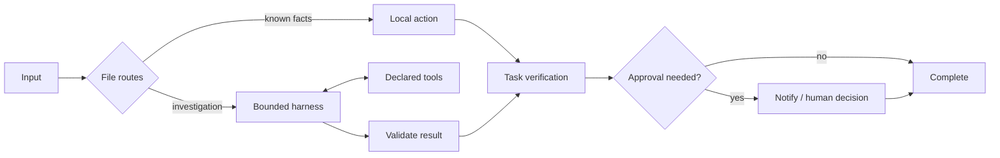

# Give Wayfile tools

Wayfile combines an outer file graph with an inner tool harness. The graph decides when investigation is needed, what evidence it may read, which capabilities it may use, and what must happen before completion. A `harness` node runs a bounded model/tool conversation and returns a validated value to the graph.

This lets one node inspect a repository or investigate a support issue without turning every possible tool call into a Markdown file. Known decisions keep their local fast paths. Open-ended work uses the model and tools.



## A node that investigates

```markdown
---
kind: harness
needs: [question]
sets: [report]
tools: [list-files, read-file, search-files]
max_turns: 6
max_tool_calls: 6
max_tool_errors: 2
max_tokens: 1000
output: json
schema: schemas/report.json
---
# Inspect the project
Read the source before making a claim. Cite a relative path and an exact
excerpt for each fact. Put unanswered questions in unknowns.

## Routes
- otherwise → [[verify-report]]
```

`needs` supplies model context. The executor receives the same projected state, keyed by its declared paths, plus `node`, `graph`, and an `AbortSignal`. Register capabilities in trusted application code, then expose only their names in the node's `tools` list. An empty list permits a bounded conversation without tools. Undeclared or unregistered tools cannot execute.

The [read-only example](../examples/harness/inspect.md) has a source fixture and an output schema:

```sh
node packages/wayfile/bin/wayfile.js check examples/harness

# .env contains OPENROUTER_API_KEY; Node loads it explicitly.
node --env-file=.env packages/wayfile/bin/wayfile.js run examples/harness \
  --input examples/harness/input.json
```

The CLI defaults the workspace to the agent directory. Use `--workspace /path/to/project` to inspect a different project. Each node still needs its own tool allowlist.

## Built-in project tools

| Tool | Behavior | Enabling it |
| --- | --- | --- |
| `list-files` | Bounded directory listing; does not follow symlinks while traversing. | Available by default. |
| `read-file` | Bounded UTF-8 read with source path and SHA-256. | Available by default. |
| `search-files` | Literal search with file/line results and explicit skipped paths. | Available by default. |
| `write-file` | Atomic UTF-8 replacement; optional `expected_sha256` detects stale reads. | `--allow-write`, or `allowWrite: true`. |
| `shell` | A timed host process with bounded stdout/stderr and an explicit exit code. | `--allow-shell`, or `allowShell: true` plus an authorization callback. |

File operations reject workspace escape and existing symlink breakout. Reads and writes protect `.env`, `.env.*`, `.git`, `.ssh`, and `.aws` path components by default. Searches report protected paths as skipped; listings can show names. Application code can explicitly enable sensitive-file access or add protected component names through `denyPaths`; a trailing `*` matches a component prefix, rather than supporting general globs. Search excludes `.git`, `node_modules`, `.wayfile`, and `runs` by default. Oversized reads or searches fail with a reason rather than silently delivering incomplete evidence.

Shell inherits a small environment allowlist instead of model and service credentials. Trusted applications can supply an explicit environment map. **Shell runs with the host user's permissions; a working directory is not an OS sandbox.** Use a container, VM, or remote executor when a task needs isolation. Scoped file helpers also do not establish an isolation boundary against an adversary concurrently changing the host filesystem.

## Application API

From a local checkout:

```js
import {
  loadGraph, run, provider, makeJudge, makeSkill,
  makeHarness, createProjectTools,
} from './packages/wayfile/src/index.js';

const graph = loadGraph('./examples/harness');
const call = provider();
if (!call) throw new Error('Configure a model provider');

const tools = createProjectTools({
  workspace: './examples/harness',
});

const result = await run(graph, {
  question: 'Which test command and report formats does the project document?',
}, {
  judge: makeJudge(call),
  skill: makeSkill(call),
  harness: makeHarness(call, { tools }),
  traceDir: './examples/harness/runs',
});

console.log(result.state.report);
```

For writes or host shell, authorization belongs in trusted application code. `makeHarness(call, { authorize })` and `createProjectTools({ authorize })` each accept a callback receiving `{ tool, args, signal, node, graph, state }`; `tool` is a string. Return exactly `true` to allow the action. Denial fails before that executor runs. The CLI's explicit capability flags authorize the selected host capabilities for that run. A live approval can instead be a separate `ask` node before an action-specific harness or executor.

## Browser, web, MCP and domain tools

The registry accepts ordinary adapters. An adapter can wrap a browser driver, authenticated API, MCP client, sandbox, artifact writer, or bounded child-agent executor. Wayfile does not ship those clients or discover them automatically.

```js
const lookupOrder = {
  name: 'lookup-order',
  description: 'Read an order for the authenticated customer.',
  input_schema: {
    type: 'object',
    properties: { order_id: { type: 'string', minLength: 1 } },
    required: ['order_id'],
    additionalProperties: false,
  },
  async execute({ order_id }, { signal }) {
    // ordersClient holds credentials and authenticated customer scope.
    return ordersClient.lookup({ orderId: order_id, signal });
  },
  toModelOutput(order) {
    return {
      id: order.id, status: order.status,
      policy_version: order.policyVersion,
    };
  },
};

const harness = makeHarness(call, {
  tools: [lookupOrder],
  maxTurns: 8,
  maxToolCalls: 12,
  toolTimeoutMs: 10_000,
});
```

The node must declare `tools: [lookup-order]`. Keep credentials inside the adapter, enforce tenant/resource scope there, and project large or sensitive results through `toModelOutput`. Only the projected result enters the model conversation and tool trace. An injected tool with a richer JSON Schema can supply `validateInput(args, context)` returning an array of validation errors; the adapter is responsible for enforcing that richer schema. Its context includes the cancellation signal and projected state. The default validator rejects unsupported schema assertions.

## Bounds, evidence and recovery

| Limit | Default | Node override |
| --- | ---: | --- |
| Model turns, including final replies/repairs | 8 | `max_turns` (1–64) |
| Tool calls | 16 | `max_tool_calls` (1–256) |
| Recoverable missing-file errors | 2 | `max_tool_errors` (0–256) |
| Output tokens per model request | 800 | `max_tokens` (1–65,536) |
| Invalid-final attempts | 2 | `max_attempts` (1 or 2) |
| Executor/validator/projection deadline | 10 seconds | `toolTimeoutMs` in application code |
| Each tool input, projected result, final result | 64 KiB | API byte limits |
| Entire model request context | 1 MiB | `maxContextBytes` in application code |
| Built-in UTF-8 file read | 32 KiB | `maxReadBytes` in `createProjectTools` |

The entire requested tool batch is checked for IDs, allowlisted names, argument contracts, and call limits before any executor in that batch runs. Valid calls execute sequentially. Missing files can return bounded error evidence for the model to recover; denial, scope violation, invalid arguments, timeout, and output overflow fail explicitly. A nonzero shell exit is returned as evidence and must be investigated. Invalid final output permits one repair within the turn budget.

Executors and custom validators must honor their signal. A timeout can stop waiting for arbitrary JavaScript, but cannot undo side effects or forcibly terminate a noncooperative adapter. The built-in shell terminates its process group. Transport failures do not silently retry. Every model request and repair contributes usage; reported cost stays unknown when billing is unavailable. Application-specific infrastructure and tool costs need their own metering.

Harness nodes never memoize. A run trace records tools, model-visible inputs and results, input/output hashes, status, timing, and model attempts, including failures. A JSON contract establishes structure; tests, evidence checks, or domain verifiers establish whether the work succeeded. For a coding agent, follow the harness with a test/build verifier and route failure back to bounded investigation or human review.

## Verify a coding tool loop

The development smoke creates an isolated fixture with a broken arithmetic function and fixed tests. The agent must reproduce the failure, edit only that source file with a read hash, and observe the original tests pass. A separate verifier checks the tests again and confirms they were unchanged. The executor permits only that writable file and one test command.

```sh
node bench/harness-smoke.js --mock
node --env-file=.env bench/harness-smoke.js
```

The first command checks the protocol with explicit mock outputs and makes no paid calls. The second uses OpenRouter and the shared experiment spend ledger. Each run saves its model journal, tool trace, source/config hashes, verification checks and cost under `bench/results/`. The October 13 Haiku 5.5 run passed with three model requests, five tool calls and $0.000802455 model API spend. This one public task demonstrates execution; it does not estimate general coding accuracy. [Evidence](bench-quality-2026-10-13.md)

## Remaining work

Checkpoint/resume across process restarts, exactly-once side effects, built-in sandbox/browser/MCP integrations, and durable human waits remain application responsibilities. Broad tool support makes tasks possible; verified outcomes and policy enforcement make them dependable. The framework should grow through measured adapters and task verifiers while keeping the file graph small enough to review.
